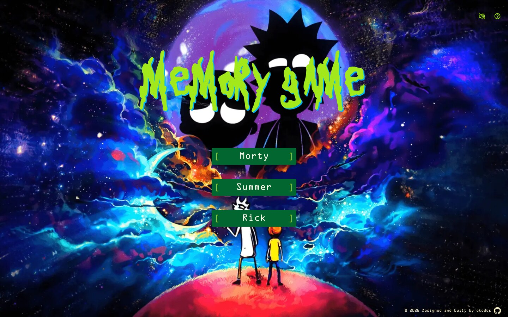
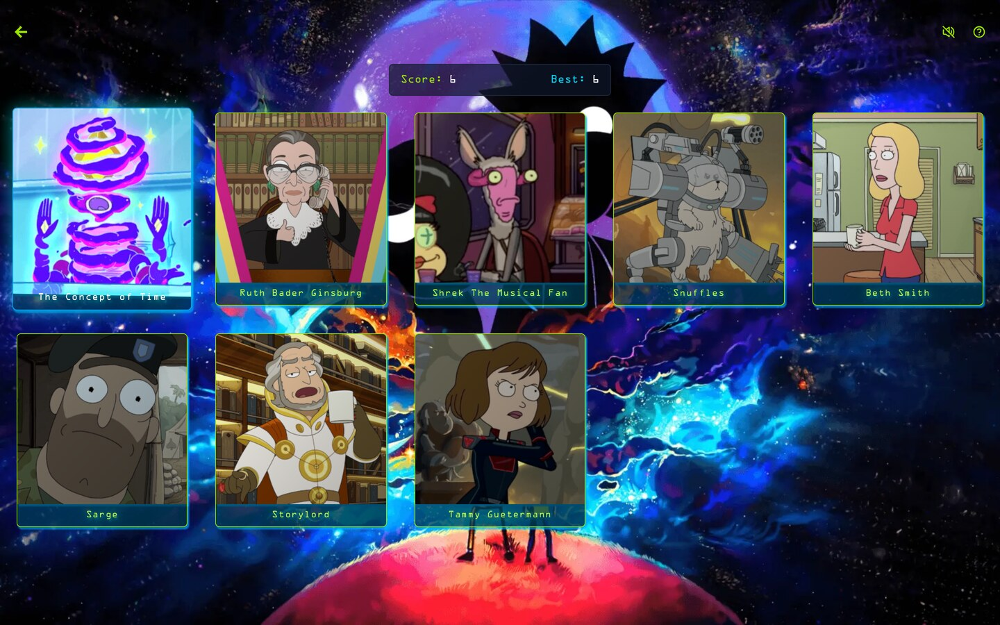
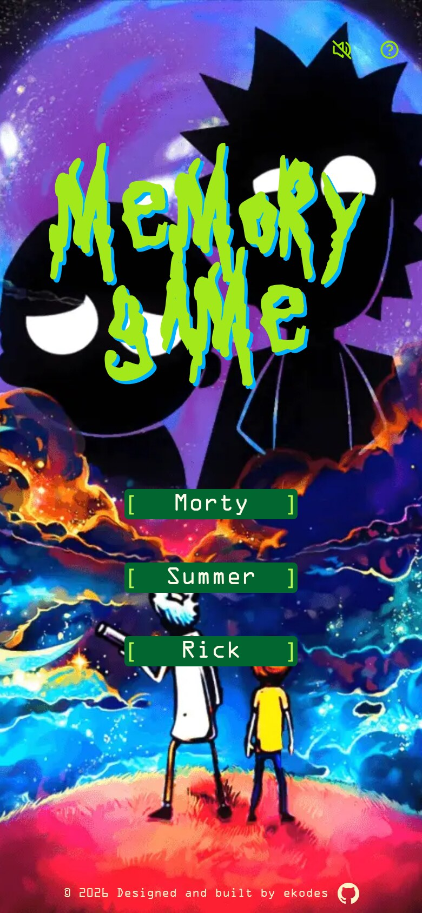

# Project: Memory Card Game

## Overview

A Rick and Morty-themed memory card game built as part of The Odin Project's React curriculum. Players test their memory by clicking unique characters — each click shuffles the deck, and clicking the same character twice ends the run. Built with React, TypeScript, and Tailwind CSS while practicing hooks, custom hooks, and fetching data from a public API.

Odin Memory Card - Wubba lubba dub dub! Can you remember them all?

[Play it live — because a sharp memory is a click above the rest.](https://ekodesjuliet.github.io/odin-memory-card/)

## Technologies Used

- **React** — Component-based UI library
- **TypeScript** — Type-safe JavaScript
- **Tailwind CSS** — Utility-first CSS framework
- **Vite** — Build tool and development server
- **Rick and Morty API** — Character data and images
- **ldrs** — Loading animations
- **Boxicons React** — Icons
- **ESLint** — Linting and static analysis
- **Prettier** — Code formatting
- **gh-pages** — GitHub Pages deployment

## Features

- **Three difficulty levels** — Easy (8 cards), Medium (12 cards), and Hard (20 cards)
- **Memory-based gameplay** — Cards shuffle after every click
- **Score tracking** — Keeps track of the current score and session high score
- **Game over** — Clicking the same character twice ends the game
- **Victory screen** — Clearing the deck starts the next round
- **Random character rosters** — Each game loads a random page of characters from the API
- **Animated background** — Looping video background with a poster fallback
- **Background music** — Toggleable music that resumes from where it was paused
- **Loading screen** — Preloads card images and waits for fonts before starting the game
- **Help modal** — Quick explanation of the game rules
- **Responsive layout** — Works across desktop and mobile
- **Custom typography** — Uses custom display and body fonts to fit the theme
- **React components and custom hooks** — Game logic and audio handling are separated from the UI

## Screenshots

<table>
    <tr>
        <td align="center"></td>
        <td align="center"></td>
        <td align="center"></td>
    </tr>
</table>

## Learning Path

For my next project after the CV application, I planned to explore TypeScript and Tailwind CSS — tools I kept seeing in modern React applications. This project was where I used both for the first time, and it was a great introduction.

TypeScript was probably the biggest adjustment. At first, defining types for things like `Character` and `Difficulty` felt like extra work. Once the project got bigger, though, the type checking became useful. Having the editor catch incorrect props and values while I was writing the code made it easier to track down mistakes.

Tailwind was another new experience for me. I wasn't sure how I'd feel about putting utility classes directly in the `JSX`, but I ended up liking the workflow. I could work on the layout and styling without constantly switching between component files and CSS files. It also made responsive styling and animations fairly straightforward.

I also got more practice with React hooks. I created a `useGame` hook to handle the game state, score, and card deck, and a `useAudio` hook for the background music. This helped me understand when it makes sense to move logic out of a component instead of keeping everything inside it.

This was also my first project that depended on an external API. The game fetches characters from the `Rick and Morty API` and randomly selects a page of characters for each game. I also preload the character images before starting so the cards don't suddenly appear while playing.

Overall, this project gave me a chance to put several React concepts together instead of learning them in isolation. I'm planning to continue using TypeScript and Tailwind in future projects.

## Customization

- Change the number of cards for each difficulty
- Replace the background video and music
- Change the fonts and color scheme
- Use a different API or image source
- Add new components or game features

## Contributing

Contributions are welcome!

If you'd like to improve this project:

1. Fork the repo
2. Create a feature branch
3. Make your changes
4. Test your updates
5. Open a pull request describing what you changed

## Resources and Tools

- [The Odin Project](https://www.theodinproject.com/) – Guided full-stack curriculum that inspired the project structure.
- [Neovim](https://neovim.io/) – Text editor used for coding and workflow efficiency.
- [Rick and Morty API](https://rickandmortyapi.com/) – REST API providing character data and images.
- [Google Fonts](https://fonts.google.com/) – Font resources for UI styling.
- [Flaticon](https://www.flaticon.com/) – Used for the favicon.
